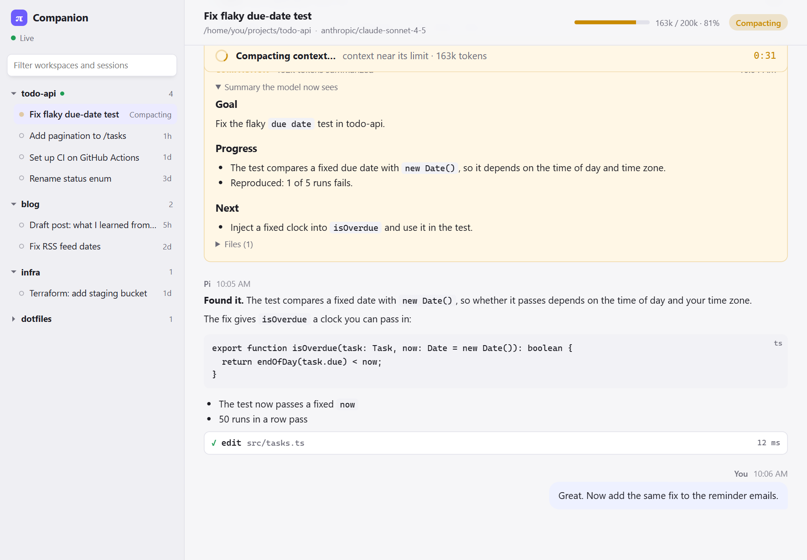

# CLI Companion

A live side window for coding-agent CLIs: [Pi](https://pi.dev), Claude Code and Codex. Keep
working in the terminal; the companion shows the same session with formatted markdown,
tool calls and their output, images, thinking, context usage, and **compaction as it
happens**. You don't need Pi to use it. Made and tested on Windows; macOS and Linux are
experimental (see [Limits](#limits)).

<picture>
  <source media="(prefers-color-scheme: dark)" srcset="docs/screenshot-dark.png">
  
</picture>

## Why

The Pi CLI is great to drive, but a long session is hard to read back in a terminal, and a
compaction gives you little to look at while it runs. The companion is a read-only window
next to it:

- **Live transcript**: your prompts, replies rendered as markdown, thinking (collapsed),
  and every tool call with its input and output. Streaming text and running tools appear
  as they happen.
- **Compaction you can see**: a "Compacting context…" banner with the reason (`/compact`,
  context near its limit, or overflow) and a timer, then "finished" or "failed". Each
  compaction becomes a card with the summary the model now sees and the files it lists;
  messages that were summarized are dimmed.
- **Context meter** and a status pill (Idle, Running, Compacting).
- **Git at a glance**: rows in Active and Recent, and the session header, show the folder's
  branch, commits not yet pushed ("2 ahead") and uncommitted changes ("+140 −3", or a file count
  when only new files). Hover for the full sentence. Refreshed every 20 seconds; read-only
  (`git status` and `git diff --numstat`).
- **Token use** for every session, Pi, Claude Code and Codex alike, read from the CLI's own
  session file: a chip in the header ("308M tokens · ~$66.51") opens the breakdown (new input,
  cache write, cache read, output, context at the last reply). Cost is shown only when the CLI
  records one: Pi's comes from the provider's prices; Claude Code's is its own estimate at API
  prices, saved now and then (a Pro or Max plan isn't billed it). Codex records no cost, so its
  chip shows your plan's 5-hour and weekly limits instead. The context meter shows for saved
  and Claude Code / Codex sessions too (Claude Code's files don't say how big the window is,
  so there it's a token count without a bar).
- **Active and Recent**: the sidebar starts with **Search sessions** (name, first message, folder,
  computer), then **Active**, a flat list of every running session with its folder name under the
  title. Sessions waiting for you come first, the one that finished most recently on top, then the
  ones still working. The browser tab title counts the ones waiting with something you haven't seen
  yet, like "(2) CLI Companion". Under it, **Recent**: the sessions you started from here with **Start Pi**
  (or its copied command), running or not (a running one is in Active too), newest first, 20 at a time (**Show more**), each with its terminal icon
  (resume it). On this computer a Pi session counts when it begins in the folder Start Pi used, a few
  minutes after (up to an hour for a copied command); sessions on an SSH computer through Start Pi's
  tunnel always count, and are remembered, so they stay listed after the connection closes (their
  history is read over ssh). Other sessions (Claude Code, Codex, Pi started on its own) show under
  Active while they run. The window follows the most recently active session unless you pick one.
  To give a session a colour (to match the tab colour you gave its terminal, say), click the **⋯**
  beside it, or right-click any session row: pick a swatch, Custom…, or No
  colour. The row gets a coloured stripe everywhere it's listed. Kept in `~/.cli-companion/session-colors.json`.
  At the bottom of the sidebar, **Start Pi** (showing which computer). It opens a popover: the
  computers as chips (**This computer**, your SSH computers, and **+** to add one), a search box,
  and that computer's folders: **Pinned** (☆ on any row pins it), **Recent** (where you started Pi
  from here, merged with where Pi sessions ran on that computer, newest first) and your home
  folder. Click a folder to start Pi in it; **⧉** copies the command instead, to paste into a
  terminal yourself. The search box finds folders by part of their name (this computer's home and
  workspace top folders, or the SSH computer's home, 4 levels down), or takes a full path as is.
  **Browse…** opens this computer's own folder window, or on an SSH computer a window that lists
  its folders one level at a time (a path box with Go, a breadcrumb, Filter folders; **Start Pi
  here** or **Copy command**). **+** asks for the computer (what you type after `ssh`) and has a
  **Test** that checks, in one ssh call: it logs in without a password, tmux and Pi are there,
  the companion is a Pi package there, and the tunnel's port is free; the ⚙ beside an SSH
  computer tests it again or removes it from the list.
  Starting Pi opens a terminal running it in the folder; on an SSH computer, inside a tmux session
  named after the folder (a new Pi window if the session is already running), so it survives a
  dropped connection. The ssh line also opens a reverse tunnel (`-R <port>:127.0.0.1:<this
  companion's port>`, the port fixed per computer, 31000–31899) and starts Pi with
  `CLI_COMPANION_PORT` set to it, so Pi's companion extension there reports here: the session
  shows in **Active** with the computer's name, live, and you can send to it; its history is read
  over ssh (kept in memory), and its Files tab lists and opens its folder there over ssh
  (read-only, inside that folder; Review and New folder aren't there yet). It shows while the ssh
  connection is open (it goes 60 s after Pi falls silent). Through the tunnel only the bridge
  (`/ingest`, `/bridge/*`) answers, with this computer's key, which starting Pi (or ⧉) on an SSH
  computer puts there first. Kept in `~/.cli-companion/computers.json` (an older
  `environments.json` is read into it once: its SSH computers added, its folders pinned).
  The left panel can be hidden with its button or **Ctrl+B** (⌘B on macOS).
- **Open in a terminal**: the small terminal icon beside a session
  opens a menu (for a session on an SSH computer, the lines are ssh commands: **Terminal here**
  opens a shell in its folder there, **Resume in Pi** resumes it in that folder's tmux session
  with the tunnel, so it shows here live again). For a workspace: **Terminal here**, then start or continue each installed CLI
  (**Start Pi**, `pi -c`, **Start Claude Code**, **Start Codex**, `codex resume --last`), and
  **Copy folder path**. For a saved session: resume it in its own CLI (`pi --session <id>`,
  `claude --resume <id>`, `codex resume <id>`). For a running session the menu offers
  **Terminal here** and says where the session is open (a terminal, or the Claude desktop app)
  instead of resuming it twice. Each option has **Copy** (the line to paste yourself, such as
  `cd 'C:\code\my-app'; pi -c` in PowerShell on Windows) and **Open**, which starts a new terminal window in
  that folder running the command: Windows Terminal or a PowerShell window on Windows,
  Terminal or iTerm2 on macOS, and the first terminal found on Linux (x-terminal-emulator,
  GNOME Terminal, Konsole, Xfce Terminal, kitty, Alacritty, WezTerm, xterm). Which one is set
  in **Settings**. On a computer with no graphical session (a headless Linux server), **Open**
  is hidden: instead the menu gives two lines to paste on another computer — step 1
  `ssh -t <host>` to open a terminal on this one, step 2 a `tmux new-session -A -s <name> …`
  line per action that attaches to (or creates, and keeps alive across SSH drops) a tmux
  session for that folder. The host is **SSH name for this computer** in Settings (what your
  other machines type after `ssh`, like `aegis` or `me@100.64.1.2`); unset, it's `user@hostname`.
  The commands come from a fixed list in the server; the page only picks one.
- **Claude Code sessions too (read-only)**: sessions from Claude Code (CLI or desktop app)
  appear in the same folders, tagged **CC**, read from `~/.claude/projects`. Open one to read
  the transcript (replies, thinking, tool calls with results, compactions, images); a running
  Claude Code (found from the small per-process files it keeps in `~/.claude/sessions`) is
  listed under Active as running or idle, and the open transcript follows it within about
  2 seconds. Files and Review work for them as well. Claude Code has no way for
  another program to type into its prompt, so for a Claude Code session the composer's button
  is **Copy for Claude**: it copies the text for you to paste into Claude Code and empties
  the box (**Bring text back** restores it).
- **Codex sessions too (read-only)**: sessions from the Codex CLI appear the same way, tagged
  **CX**, read from `~/.codex/sessions` with titles from `~/.codex/session_index.jsonl`:
  prompts, replies, reasoning summaries, tool calls with their output, compactions and pasted
  images. A Codex that is open is listed under Active (on Windows, from the lock Codex holds
  on a loaded session, matched against the Codex windows that are open, since Codex's background
  service keeps a session loaded for a while after its window quits), as running or idle from its
  last task event. The composer's
  button is **Copy for Codex**. Tested with Codex CLI 0.166.
- **Suggested replies** (off until you switch them on in Settings): when a running session
  you're viewing finishes a turn, a model on this computer's Ollama suggests a few replies,
  shown as buttons above the composer text. If the CLI asked you to choose (numbered options,
  "A or B?", yes or no), the buttons are those choices. Click one to put it in the composer,
  then send or copy it as usual. Only local models can be picked, so the conversation never
  leaves the computer. The first suggestion after a while waits for the model to load.
- **Send text to Pi (bottom composer)**: write or collect text, then **Put in Pi's input**
  (**Ctrl+Enter**). It lands in the running Pi CLI's prompt box, with a short notice in the
  terminal; press Enter there to send it. **Ctrl+Shift+Enter** puts the text in and sends it
  in one go. If
  Pi is busy, the message waits until it finishes. `/` commands and `!` shell lines are left
  for you to send from the terminal.
  **Images**: paste one (Ctrl+V), drop it on the composer, or click **Image**. It is saved in the
  session's folder under `.cli-companion/images/` (PNG, JPEG, GIF or WebP, up to 20 MB) and its
  path goes into the text where the cursor is, so Pi, Claude Code or Codex can open it. A
  thumbnail shows above the text; × takes the path out again. That folder has its own
  `.gitignore`, so git ignores the images, and images older than 30 days are deleted. Not
  available from the phone.
  Type **/** at the start of a line for a list of the selected CLI's slash commands (↑/↓,
  Enter or Tab to insert, Esc to close). For Pi: its built-ins plus the extension, prompt and
  skill commands the running Pi reports. For Claude Code: its common built-ins plus your
  commands and skills from `~/.claude` and the project's `.claude` folder.
  Every code block, message, tool input/output, file (Files tab) and diff (Review tab) has
  **Copy** and **Add** buttons; Add drops it into the composer as a fenced block. Each session has
  its own draft (text typed for one session doesn't follow you to another), kept if you close
  the window. Works for running terminal sessions; sessions opened before
  the extension was updated need `/reload` once.
- **Resizable panels**: drag the inner edge of the left or right panel (or focus it and use
  ←/→; Shift for bigger steps). Double-click an edge to reset its width. Widths are
  remembered, and the transcript always keeps at least 360 px.
- **Right panel (Files, Review, Apps and Terminal)** for the selected session's
  folder. Toggle it with the button at the top right or **Ctrl+Alt+B**.
  - **Files**: browse the folder tree and read files with line numbers. Markdown is
    rendered (with a Source toggle) and images are shown. **New folder**: the folder-plus button
    in the bar creates one in the session's folder; the one beside a folder (on hover) creates one
    inside it. Type a name, Enter to create, Esc to cancel. It never overwrites anything.
  - **Review**: git changes, either **Uncommitted** (including untracked files) or
    **Branch** (everything since the branch split from main/master), with +/− counts and
    a coloured diff per file. **Changed in this session** lists the files Pi edited or
    wrote in the open session.
  - **Terminal** (off until you turn it on in Settings → **Terminal tab**): run a command in the
    session's folder (PowerShell on Windows, your login shell elsewhere) and watch its output, with
    **Stop** (or Ctrl+C), ↑/↓ for earlier commands and a terminal-style screen of the recent runs. Code
    blocks in replies (PowerShell, shell, cmd…) get a **▶ Terminal** button that puts the command at
    the prompt; **nothing runs until you press Enter (or ▶)**. Commands get no input, so programs you type into (codex, pi, ssh, a REPL) go to
    **Open in terminal**, which opens a real terminal window in that folder with the command. Output
    is kept in memory only. Not available from the phone.
  - **Apps**: when the **last exchange** (your last message and the reply to it) names an app, the app
    is listed here (only that exchange is read, to keep noise down): local web addresses such as
    `http://localhost:5173` (marked Running or Not running), pages on your tailnet or on an SSH
    computer you added under Start Pi (such as `http://100.72.12.1:8090/`; for a session running
    on that computer, its `localhost` links point there), and files inside the session's
    folder that the panel can show: `.html` pages, images, video, audio, PDFs and text (`.txt`,
    `.md`, `.csv`, `.log`; code files are left out). Video can be seeked; Markdown is rendered.
    Files outside the session's folder are never served. A dot on the tab means something new. Click one to open it in the panel, open it in the
    browser, or **Pin to Dashboards** to keep it in the Dashboards menu (never added by itself).
    HTML files are served from `/app-files/…` in a sandbox (its own origin, so its scripts can't
    use the companion; browser storage and loading local JSON with fetch don't work there).
  - Otherwise read-only by design: no editing of files and no terminal inside the page (your terminal is where Pi runs).
- **First run**: with no sessions anywhere yet, the window shows which CLIs it found, where it
  looked, and how to start each one.
- **Command palette** (Ctrl+K, or **⌘ Commands** in the composer): a box over the app to find
  things by typing. The selected session's CLI commands (`/compact`, `/model`, …): Enter puts
  the command in Pi's input, Ctrl+Enter also runs it; for Claude Code and Codex it is copied to
  paste. Also your saved prompts, every session (running ones first) and the companion's pages
  and panels.
- **Prompts** (composer): prompts you send often. Click one to put it in the composer, where you
  can edit it before sending. A prompt is for every CLI or just one. **Manage** adds, edits,
  reorders and removes them, **Save composer text** keeps what you've typed, and **From your
  history** lists messages you typed more than once (from the search index, in memory) to save
  with one click. Kept in `~/.cli-companion/prompts.json`; read-only on the phone.
- **Hand off** (session header, or "Hand off this session" in the palette): move the work to
  another CLI, or take it out. **Copy handoff brief** puts a Markdown brief on the clipboard: where
  the session started, the last compaction summary, the recent messages, the latest exchange in
  full, the files it wrote or edited, git state, and the transcript's path. **Continue in Pi /
  Claude Code / Codex** saves that brief in `~/.cli-companion/handoffs` (newest 20 kept) and opens
  a terminal in the session's folder running that CLI, told to read it. **Download brief** and
  **Download whole session** (messages and tool calls, no tool output) save a `.md` file. The
  brief is put together from the session itself; no model is involved.
- **Menu bar: Home, Search, Dashboards, Settings, About.** Home is the session view.
  - **Search** (Ctrl+Shift+F) finds words in every session of every CLI: what you typed and
    the replies, not tool output or thinking. All words must be in one message; "quotes" for a
    phrase. Results are grouped by session, newest first; click one to open the session at
    that message. The text is held in memory only, never written to disk; the first search
    after the server starts reads every session file (about 10 seconds for a few GB), later
    ones only what was added.
  - **Dashboards** has built-in dashboards and your own. **Usage overview** shows sessions
    started per day in each CLI (7, 30 or 90 days, with a table view), active days
    and your busiest workspaces, all from the session files already indexed, and **tokens**:
    totals, how much came from cache, estimated cost, tokens per day by CLI, and the sessions
    that used the most (click one to open it). The first visit reads every session file once
    (a few seconds for gigabytes); after that only new lines are read, and the counts are kept
    in `~/.cli-companion/token-usage.json`. **Custom**
    dashboards are links to any page, such as a local server's status page: add them with the
    form, open them inside the companion or in a new tab. Ones on this computer show online
    or offline. A dashboard can also keep the command that starts its server: when it is
    offline, opening it shows **isn't running** with that command to **Copy**, or to **Run it**
    (only with Settings → Terminal → *Let the companion run commands* on; it starts in the
    background, without a window, and the dashboard loads itself once it answers).
    The list is kept in `~/.cli-companion/dashboards.json`.
    **Old sessions** lists saved sessions you have not used for 14, 30, 60 or 90+ days (not running),
    oldest, largest or most tokens first, with the space they use. Read-only: open one, or copy its
    file path; nothing is moved or deleted.
  - **Settings**: show or hide each CLI (Pi, Claude Code, Codex), change where its folder is,
    pick the terminal **Open** uses, and switch on suggested replies with a local Ollama model.
    For Pi, **Composer button** chooses whether the composer only puts text in Pi's input (you
    press Enter, the default) or also presses Enter; Ctrl+Shift+Enter does the other one. Claude
    Code and Codex stay copy-and-paste. Saved in `~/.cli-companion/settings.json`; changes apply at once.
    **Appearance**: theme (match this computer, light or dark), 12- or 24-hour times (or this
    computer's choice), and switches for cost estimates and
    for git branch and changes. For text size, use the browser zoom.
    **Shortcut**: add or remove a **CLI Companion** shortcut in the Start menu or on the desktop
    (see Install).
    **Phone access** (off by default): open the companion on your phone through
    [Tailscale](https://tailscale.com). Switching it on runs `tailscale serve`, which forwards
    `https://<this computer>.<your tailnet>.ts.net` to the companion; the server itself still listens
    on 127.0.0.1 only. A request from the phone is accepted only when phone access is on, it is
    addressed to this computer's Tailscale name, and Tailscale says it comes from the account that
    owns this computer's Tailscale (your own devices); no token to type. From the phone you can read
    sessions, search, use dashboards and copy or download a handoff brief. **Allow replies to Pi**
    (off by default) also lets the composer put text in, or send it to, a running Pi session.
    Never from the phone: terminals, Continue in…, settings, shortcuts, favorites, session colours, dashboards,
    new folders, restart. Switching it off removes the `tailscale serve` entry (only if it points
    at the companion; an existing serve entry for something else is left alone and blocks turning
    it on). Needs Tailscale on both devices, signed in to the same account, with HTTPS certificates
    on for the tailnet.
  - **About** shows the version, this server's address and folders, shortcuts and privacy,
    and has **Restart server** (picks up new code; open sessions stay open).

## Install

Needs [Node.js](https://nodejs.org) 20 or newer, and [Git](https://git-scm.com) (npm uses it to
fetch the package from GitHub; the Review panel uses it too).

**Without Pi** (Claude Code, or just to look around):

```bash
npx github:mcgowee/cli-companion
```

This starts the companion server if it is not running and opens the window. It opens as an
app window if Chrome, Chromium or Edge is installed, otherwise in your default browser. To
have the `cli-companion` command on your PATH, install it once:

```bash
npm install -g git+https://github.com/mcgowee/cli-companion.git
cli-companion              # start (if needed) and open the window
cli-companion --no-open    # start the server only; prints the address to open
cli-companion --foreground # run the server in this terminal; Ctrl+C stops it
cli-companion --restart    # stop the running server, start a fresh one, open the window
cli-companion --stop       # stop the running server
cli-companion --shortcut   # add a CLI Companion shortcut to the Start menu (--shortcut=desktop)
cli-companion --help
```

The server keeps running in the background after the command exits (closing the window
doesn't stop it; use `--stop`, or **Restart server** on the About page). To open it in another
browser, run `cli-companion --no-open` and open the address it prints: it carries your access
key (see [Privacy](#privacy)); plain <http://127.0.0.1:30143> only shows how to get in.

**A shortcut to click:** Settings → **Shortcut** → **Add** (or `cli-companion --shortcut`) puts
a **CLI Companion** shortcut, with its own icon, in the Start menu, or on the desktop. It starts
the companion if it isn't running and opens the window, with no terminal; right-click it to pin
it to the taskbar or Start. With Chrome, the window groups under that pin, and pinning the open
window pins the shortcut (not plain Chrome); with Edge, pin the shortcut itself. On Linux it is a `.desktop` file in `~/.local/share/applications`;
macOS isn't supported yet. The shortcut runs the copy that made it, so remove it in Settings
before you uninstall. It can't be made from an `npx` run (npm clears that copy); install with
`npm install -g` first.

**With Pi**, install it as a Pi package. This adds the live view of Pi sessions (status,
streaming text, tools, compaction) and **Put in Pi's input**:

```bash
pi install git:github.com/mcgowee/cli-companion
```

Then, in any Pi session:

```
/companion
```

This does the same as `cli-companion`. Sessions that were already open when you installed
need `/reload` once. `/companion server` starts the server without opening a window.
(Installs from the old name, `pi-companion`, keep working.)

## How it works

Each CLI is a *source* in `server/sources/` (`pi.mjs`, `claude.mjs`, `codex.mjs`) with the same
shape: where its sessions are and how to read one, whether one is running, its start and resume
commands, and its slash commands. Adding a CLI means adding one module there.

```
Pi (interactive) ──events──► companion server ──SSE──► window
 extension/companion.ts      server/server.mjs         public/
                             reads the session file ◄── history
```

- The **extension** forwards live events (streaming text, tool start/update/end, turns,
  model, context usage, compaction start/end/failure) to the server with a short HTTP POST.
  It never returns a value from an event handler, so it cannot cancel or change anything
  Pi does. It does nothing in print/JSON mode. If the server is not running, events are
  dropped quietly; a heartbeat every 15 s makes running sessions appear once it starts.
- The **server** (Node built-ins only, no dependencies) listens on `127.0.0.1` only. It
  builds the workspace list from Pi's sessions folder, reading only the start and end of
  each file (session files can be hundreds of MB with images), cached until a file
  changes. It reads history only from inside that folder and keeps no session text on disk
  except handoff briefs you ask for. It never writes the CLIs' own files; what it does write
  is listed under [Privacy](#privacy).
  The right panel only reads inside the folder of a session it knows (the page sends a
  session id, never a path), rejects `..` and symlinks that lead outside it, and runs
  only read-only `git` commands. Its one write, New folder, also stays inside that folder and
  needs the page's own request header. App files from that folder are sent with a sandbox policy. Requests whose `Host` is not `127.0.0.1`/`localhost`
  are refused, which blocks DNS-rebinding attacks from web pages, and every request for session
  data must carry the access key (see [Privacy](#privacy)).
- **Sending to Pi**: Pi never opens a port. The extension in each interactive Pi keeps one
  request open to the server (`/bridge/inbox`) and receives only commands for its own
  session; it pastes the text with Pi's `ctx.ui.pasteToEditor` and reports back. The page's
  send request needs a custom header (a cross-site page can't add one without a CORS
  preflight, which is never answered), and a command nobody picks up within 20 s is dropped.
- The **window** is plain HTML and JavaScript: no build step and no CDN.

## Privacy

Everything stays on this computer. The server listens on `127.0.0.1` only, and every request
for your sessions must carry this computer's **access key** (`~/.cli-companion/access-key`,
readable only by you), so other accounts on a shared computer can't read your transcripts.
The window gets the key once in its address and keeps it as a cookie; the Pi extension and
the `cli-companion` command send it as a header. With phone access on, your phone is checked
by your Tailscale account instead.

What the companion writes (all in `~/.cli-companion`, or `CLI_COMPANION_HOME`, unless noted):

| File | What |
|---|---|
| `settings.json` | The Settings page |
| `access-key` | The access key (made on first start) |
| `favorites.json`, `session-colors.json`, `dashboards.json`, `prompts.json` | Starred items (from before Recent replaced Favorites; no longer written), session colours (ids and colours only), custom dashboards (with their start commands), saved prompts |
| `computers.json` | Start Pi: the SSH computers you added (names), pinned folders, folders you started Pi in, which computer is picked, and sessions that ran there through the tunnel (id, session file and folder there, name, time) |
| An SSH computer's `~/.cli-companion-tunnel/access-key` | This computer's access key (readable only by you there), put there when you start Pi (or copy its command) on an SSH computer, so Pi there can report through the tunnel |
| `token-usage.json` | Token counts per session file (a cache; safe to delete) |
| `handoffs/` | Handoff briefs you made (newest 20 kept) |
| `remote.json` | Phone access on/off and your Tailscale name |
| `server.json` | The running server's port and pid, written when it starts and removed when it stops cleanly (so Pis and CLIs started later find the right port) |
| `server.log` (and `server.log.1`) | The background server's output, capped at 2 MB |
| `browser-profile/` | The app window's own Chrome/Edge profile |
| Start menu / desktop | The **CLI Companion** shortcut, only if you add one |
| `tailscale serve` | One forwarding entry, only while phone access is on |
| A session's folder | **New folder** in the Files panel, only when you make one |
| A session's `.cli-companion/images/` | Images you add in the composer (older than 30 days deleted), and a `.gitignore` there |

It never writes the CLIs' files (Pi's, Claude Code's or Codex's sessions and settings). Suggested
replies use a local [Ollama](https://ollama.com) model only, and only if you turn them on.

## Settings

Most people only need the **Settings** page. The same things can be set with environment
variables (a `CLI_COMPANION_<CLI>=0` variable always hides that CLI, whatever the page says):

| Variable | Default | Meaning |
|---|---|---|
| `CLI_COMPANION_PORT` | `30143` | Port for the server and the extension (`PI_COMPANION_PORT` also works); wins over the running server's port (`server.json`) and the port in Settings |
| `PI_CODING_AGENT_DIR` | `~/.pi/agent` | Pi's folder (sessions are read from `sessions/`) |
| `CLAUDE_CONFIG_DIR` | `~/.claude` | Claude Code's folder (transcripts are read from `projects/`) |
| `CLI_COMPANION_CLAUDE` | on | Set to `0` to hide Claude Code sessions (`PI_COMPANION_CLAUDE` also works) |
| `CODEX_HOME` | `~/.codex` | Codex's folder (sessions are read from `sessions/`) |
| `CLI_COMPANION_CODEX` | on | Set to `0` to hide Codex sessions |
| `CLI_COMPANION_PI` | on | Set to `0` to hide saved Pi sessions |
| `CLI_COMPANION_HOME` | `~/.cli-companion` | The companion's own files (see [Privacy](#privacy)) |
| `OLLAMA_HOST` | `http://127.0.0.1:11434` | Ollama for suggested replies (only an address on this computer is used) |

Older versions kept these files in `~/.pi/agent/companion/`; the dashboard list is copied
over on first start.

## Limits

- Pulling Pi's draft into the composer for editing is planned. Images go in by path; they're
  not attached to the message directly.
- Past sessions open read-only; resume one with the terminal icon beside it.
- **Needs you** (amber dot, header pill, tab-title count) means a CLI is asking you something in
  its terminal: an approval or a question. Answer it there. Claude Code says so itself. Codex
  doesn't record its prompts, so a Codex turn with a tool call that has had no result and no
  writes for 8 s counts as "maybe an approval"; a long-running command can look the same.
- Tested on Windows 11 with Pi 1.4, Claude Code 2.1 and Codex CLI 0.166. **macOS and Linux are
  experimental**: they use the same code but haven't been tested yet; reports welcome. There, a
  running Codex is recognised only by recent writes to its session file, and on macOS **Open**
  needs permission to control Terminal or iTerm2 (System Settings → Privacy & Security →
  Automation).

## Develop

```bash
npm test              # tests (node:test)
npm start             # run the server in the foreground
node bin/cli-companion.mjs   # the standalone command from a checkout
pi -e ./ ...          # try the extension from a checkout without installing it
```

## License

MIT
